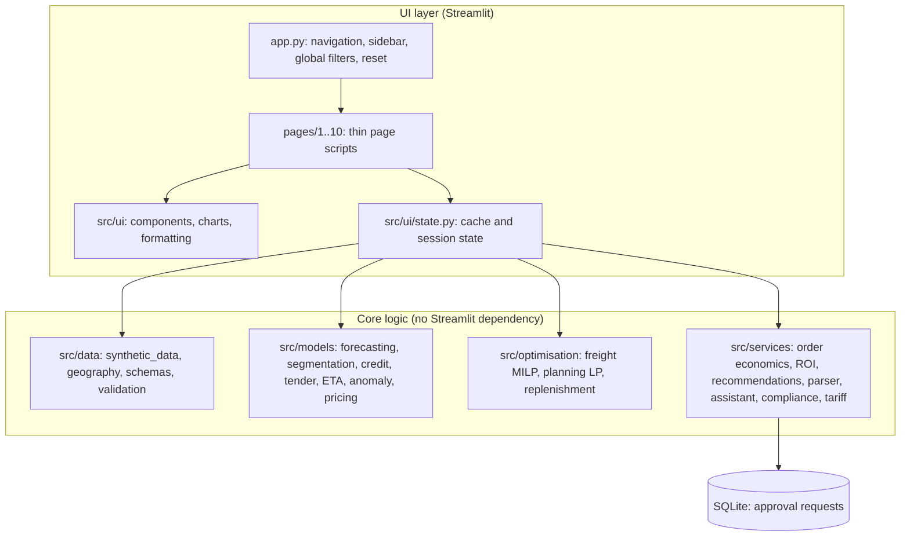
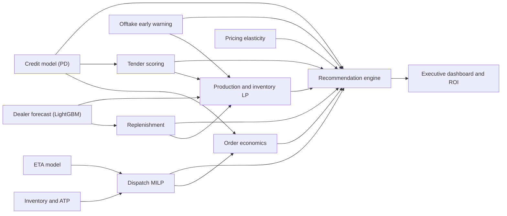

# Technical Architecture: Dalmia AI Intelligence Hub (POC)

All data in this proof of concept is synthetic. This document describes how the code is organised and how data and decisions flow.

## 1. Layers

* **Pages** only arrange widgets and charts. They call `src/ui/state.py`, which wraps core functions in caches.
* **Core modules** are pure Python (pandas, NumPy, scikit-learn, LightGBM, SciPy, statsmodels) and are unit-tested directly.
* There are no circular imports. Dependencies run `ui → services/optimisation/models → data → config`.

## 2. Synthetic environment

`generate_environment(DataSettings)` builds every table from one seeded `numpy.random.Generator`.

| Entity | Rows (default) | Key relationships |
|---|---|---|
| Plants / depots | 8 / 14 | Real Indian city coordinates; capability by product category; depot mother plant |
| Dealers / series | 500 / ~920 | Region weight, tier size, nearest depot, sales rep, credit limit, latent payment risk |
| Dealer weekly sell-in | ~96k | Seasonality (peak Jan-May, monsoon dip, festive recovery), trend, injected declines, intermittency, gamma noise |
| Institutional customers / projects | 250 / 120 | Segment-specific risk; project S-curve plans; injected slowdowns with cancellations and deferments |
| Orders / invoices | ~67k each | Price from regional monthly index; freight from the shared tariff and actual distance; payment timing from risk with drift |
| Trips (GPS) | 4,000 | Transit depends on distance, vehicle, route, monsoon and night driving; labelled anomalies plus benign variation |
| Inventory, open orders, vehicles | Snapshot | Available-to-promise stock, urgency deadlines, contracted fleet by source |
| Tenders | 420 historical + 30 open | Outcome is a logistic function of price position, eligibility, capability and competition; documents rendered as text |
| Compliance | 7 products, 6 projects | Synthetic specs and lab tests, deliberate evidence gaps, certificates, consultant approvals |
| Pricing panel | 2,160 | Constant-elasticity demand response with competitor indicator and demand index |

Freight is costed by one function (`src/services/freight_tariff.py`) in the generator, optimiser and order economics, so figures reconcile across pages.

## 3. Data and decision flow

## 4. Caching and state

| Item | Mechanism | Invalidated by |
|---|---|---|
| Environment, trained models | `st.cache_resource` keyed by (seed, dealers, weeks, institutional) | Regenerate data |
| Replenishment, credit policy, tender scoring | `st.cache_data` keyed by parameter values | Their own assumptions only |
| Dispatch plan, production plan | `st.cache_resource` keyed by the scenario `repr` | Their own assumptions only |
| Scenario assumptions | `st.session_state` objects (`freight_scenario`, `planning_scenario`, ...) | Reset scenario assumptions |

Changing a freight rate re-solves only the dispatch MILP. Changing the forecast horizon or service level recomputes replenishment, and through it the planning demand. No unrelated model is retrained.

## 5. Optimisation formulations

**Dispatch MILP** (`freight_optimisation.py`). Binary `x[o,s,v,m]` per feasible order-source-vehicle-fleet option, plus `u[o]` for unserved orders.
The objective minimises sourcing, handling, trip freight (including empty return) and penalties.
Constraints: one option per order; ATP by source and product; loading capacity by source; fleet occupancy by source, type and mode (trucks / cycles); deadline feasibility (pre-filtered using the ETA model).
Solved with HiGHS, with a 30 s limit and a greedy fallback.

**Planning LP** (`inventory_optimisation.py`). Weekly variables for production, overtime, plant-to-depot shipments, depot-to-depot transfers, plant and depot inventory, unmet demand and safety-stock shortfall.
Constraints: conservation, capacity, shutdowns and storage.
The baseline heuristic is simulated with the same cost accounting, so totals are comparable.

## 6. Generative-AI components without an LLM

* `document_parser.py`: TXT/PDF reading (pypdf) with type, size and page validation, plus regex field extraction with evidence snippets.
* `tender_scoring.tender_briefing` and `compliance.compliance_report_text`: deterministic templates over extracted and computed facts.
* `document_assistant.py`: chunking with metadata, TF-IDF retrieval, intent-aware re-ranking, role filtering and an extractive template answer with chunk citations. `AnswerGenerator` is the adapter protocol. `EnterpriseLLMAdapter` is the placeholder for an approved model, which must receive only retrieved chunks and return citations.

## 7. Testing

`pytest` (53 tests) covers data reproducibility and referential integrity, economics reconciliation, ROI formulas, optimiser constraints (deadlines, ATP, capacity, disabled sources, shutdowns) and model leakage controls.
It also covers metric correctness, compliance "missing evidence is never PASS", assistant grounding and permissions, recommendation responsiveness, and an AppTest render of all 10 pages.
